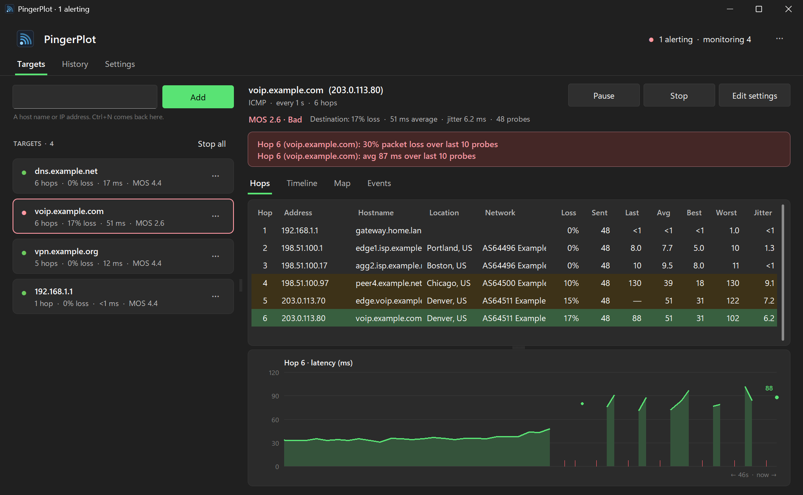

# PingerPlot

[](https://github.com/jamesccupps/PingerPlot/releases/latest)
[](https://github.com/jamesccupps/PingerPlot/actions/workflows/ci.yml)
[](LICENSE)

Shows you *where* along a network path a connection goes wrong. Like `mtr` or WinMTR, PingerPlot finds every
router between you and a target and then keeps probing all of them, so loss, latency, jitter and a voice-quality
score build up per hop over minutes or days. A problem that starts at your gateway, your ISP's first hop, a peering
point or the destination shows up at that hop and every hop after it. It runs in the notification area, alerts you
when the destination degrades, and needs no administrator rights for ICMP.

**[⬇ Download for Windows](https://github.com/jamesccupps/PingerPlot/releases/latest/download/PingerPlot-Setup.exe)**
(`PingerPlot-Setup.exe`, Windows 10 or 11, 64-bit) ·
[Portable zip](https://github.com/jamesccupps/PingerPlot/releases/latest/download/PingerPlot-win64.zip) ·
[All releases](https://github.com/jamesccupps/PingerPlot/releases) ·
[Linux](#linux) ·
[Website](https://jamesccupps.github.io/PingerPlot/)



<sub>Demo mode: simulated paths with documentation addresses.</sub>

- **Every hop, all the time.** Each round is a full traceroute, so every hop gets current, average, best and worst
  latency, jitter and loss over time, not a single snapshot.
- **The path over time.** The Timeline draws every hop on one time axis: a latency step shows up as the row where
  the bars get tall, and stays tall for every hop after it.
- **Alerts that mean something.** Sustained loss, latency or a poor MOS at the *destination*, over a window you
  choose, never a router in the middle that just deprioritises ICMP. A banner, a sound, a Windows notification and
  an optional webhook (Slack, Teams, ntfy, Home Assistant…).
- **Route changes, live.** A hop whose router changes, or a path that grows or shrinks, goes into the Events list.
- **Many targets at once,** each with its own settings, each a card with its hop count, loss, latency and MOS.
- **MOS**, the ITU-T E-model's 1 to 5 voice-quality score, for the destination: one number for "is this path good
  enough for a call".
- **ICMP, TCP and UDP probes**, DSCP marking (measure the path as voice or video traffic) and a fixed source address
  on a multi-homed PC.
- **Runs in the background.** Closing the window keeps every target monitored from the notification area; *Start
  with Windows* puts it there when you sign in.
- **Keeps a record.** Every probe to a size-capped CSV per target, sessions you can save, reopen and compare with
  a later run, and a CSV export of the hop table.
- **Signed downloads and updates.** From 1.4.4 the installer and the programs are code-signed by James Cupps. It
  checks GitHub once a day and installs a new version with one click, only if the download carries the release
  signature built into the app.
- **A headless runner** for a server or Task Scheduler, with a one-shot report mode for tickets.
- **Looks at home on Windows 11**, light or dark, following Windows, sharp at any display scale. Pure Python
  standard library, no third-party dependencies.

## Install

**Installer (recommended):** download
[`PingerPlot-Setup.exe`](https://github.com/jamesccupps/PingerPlot/releases/latest/download/PingerPlot-Setup.exe)
and run it.

- It installs for your Windows user only, with no admin prompt, into `%LOCALAPPDATA%\Programs\PingerPlot`.
- It adds a Start menu shortcut (and a desktop one if you tick it) and appears in **Settings → Apps** for
  uninstalling.
- From 1.4.4 the installer and the app are code-signed by **James Cupps**. If SmartScreen still warns about a new
  release, **More info** shows that publisher. Each release lists the SHA-256 of every file in `SHA256SUMS.txt`.

**Portable:** download
[`PingerPlot-win64.zip`](https://github.com/jamesccupps/PingerPlot/releases/latest/download/PingerPlot-win64.zip)
and unzip it somewhere of your own, e.g. a USB stick or `%LOCALAPPDATA%\Programs`. It keeps its settings in its own
folder (that's what the `portable.txt` beside it does), and updates itself in place. Avoid `C:\Program Files`,
which it can't write to.

**Install with Scoop:** if you use [Scoop](https://scoop.sh) (its site has the one-line install if you don't):

```powershell
scoop bucket add jamesccupps https://github.com/jamesccupps/scoop-bucket
scoop install jamesccupps/pingerplot
```

It installs the portable zip with a Start menu shortcut, keeps its settings in `%APPDATA%\PingerPlot`, and puts
`pingerplot-headless` on your PATH. `scoop update pingerplot` updates it.

**Linux:** see [Linux](#linux) below: one `pipx` command.

**From source** (Windows, Linux, macOS): Python 3.10 or newer, nothing to `pip install`.
`git clone https://github.com/jamesccupps/PingerPlot`, then `python main.py`, or on Windows double-click
`PingerPlot.vbs` (no console window). See [Running from source](#running-from-source) for shortcuts and an elevated
logon task.

> **About antivirus warnings.** Some antivirus engines flag PyInstaller programs heuristically, and this one is a
> worse-than-average case: it calls into `iphlpapi` through `ctypes`, can open raw capture sockets and maps network
> paths, which is a fair description of both a diagnostic tool and something you wouldn't want running unasked. The
> files are built by CI from the tagged commit, signed, and tested before they're published (releases up to 1.4.3
> were unsigned). If you'd rather not run a downloaded program at all, run it from source: it's the same program.

### Linux

PingerPlot runs on Linux from Python, with nothing to compile and no dependencies beyond Tk. It needs Python 3.10
or newer and Tk, which most distributions package separately:

| Distribution | Tk |
|---|---|
| Debian, Ubuntu, Mint | `sudo apt install python3-tk` |
| Fedora, RHEL | `sudo dnf install python3-tkinter` |
| Arch, Manjaro | `sudo pacman -S tk` |
| openSUSE | `sudo zypper install python3-tk` |

Then, with [pipx](https://pipx.pypa.io/) (`sudo apt install pipx` on Debian and Ubuntu, `sudo dnf install pipx` on
Fedora, `sudo pacman -S python-pipx` on Arch), install it for your user and start it:

```bash
pipx install git+https://github.com/jamesccupps/PingerPlot
pingerplot
```

In **Settings**, turn on **Show in the applications menu** to add it, with its icon, to your desktop's menu and
search, and **Start when you sign in** if you want it monitoring from sign-in. To update: `pipx reinstall
pingerplot` (the app checks once a day and says when there's a new version). To remove it, see
[Uninstalling](#uninstalling). Or skip pipx: `git clone` and `python3 main.py` works the same.

ICMP needs no root: it uses the kernel's unprivileged ICMP sockets, which most systemd-based distributions allow
by default. If PingerPlot says the ICMP backend is unavailable, it names the one `sysctl` to run.

What's different from Windows:

- There's no notification-area icon (Tk has no way to make one without extra packages), so closing the window
  quits. *Start when you sign in* opens it minimized instead.
- Alerts notify through `notify-send` (libnotify, on nearly every desktop) and ring Tk's bell (the desktop's
  alert sound, where it has one). Clicking a notification doesn't open the target.
- *Match the system* follows the desktop's light or dark setting (GNOME, KDE Plasma and others, through the
  freedesktop settings portal).
- Full TCP and UDP traceroute is Windows-only for now: it relies on a Windows raw-capture feature. ICMP, and TCP to
  the destination (*Destination only*), work everywhere.
- The headless runner is `pingerplot-headless`.

CI starts the app on Ubuntu on every push: the window's self-test, a probe of loopback, the pipx install, and
`desktop-file-validate` on its menu and autostart entries.

## Use

1. Type a host name or IP address in the box at the top left (your gateway, `8.8.8.8`, a server you care about)
   and press **Add**. Add as many as you like; each gets a card.
2. Click a card to see that target: its status and MOS, then four views.
   - **Hops**: the table (address, hostname, loss, sent, last, average, best, worst, jitter), rows amber or red
     on loss or high latency, over a latency graph. Click a row to graph that hop; until you do, it follows the
     destination.
   - **Timeline**: every hop stacked on one time axis.
   - **Map**: the public hops located on a map zoomed to the path (see [privacy](#updates-and-privacy)).
   - **Events**: route changes, alerts raised and cleared, warnings.
3. **Pause**, **Stop** and **Edit settings** are at the top right. Editing a target's settings restarts it with
   them.

- **⋯** on a card, or a right-click, has *Edit settings…*, *Pause*/*Resume*, *Stop*/*Start* and *Remove*.
  Right-click a hop to copy its address, hostname or row. Ctrl+N goes back to the box.
- **Settings** holds the defaults for new targets (probing, alerts, logging and webhooks) and the app's own
  options: theme, resuming your targets at start, Start with Windows, the notification area, notifications and
  updates.
- **⋯** at the top right: export the hop table as CSV, save a session, open one, compare with a saved one, check
  for updates, report a problem.
- The tray icon is gray when nothing is monitored and gets a red badge while a target is alerting. Click it to open
  the window; right-click for *Stop all*, *Start with Windows* and *Quit*.

## Reading the results

- **Loss at a hop in the middle while the destination stays clean is normal.** Many routers rate-limit or ignore
  the "TTL exceeded" messages they're asked to generate. Only loss that carries through to the destination (the
  last row) is a problem on the path.
- A latency *step* that appears at one hop and stays in every hop after it is where the delay comes in.
- Sub-millisecond hops show as `<1`: the Windows ICMP API reports whole milliseconds.
- **Jitter** is the average change in RTT from one reply to the next (lost probes skipped): what a jitter buffer
  has to absorb, and what the MOS formula expects. A path that steps from a steady 20 ms to a steady 60 ms has a
  latency change, not jitter. (Before 1.3.3 this column was the standard deviation of RTT, which counted that step as
  jitter for as long as it sat in the window.)
- **MOS** runs from 1 to 5: 4.3 and up is excellent, under 3.6 is poor for a call.

## Alerts

**Settings → Alerts** (or a target's **Edit settings**): packet loss at or above X %, average latency at or above
Y ms, MOS at or below Z, over the last N probes. The window is what makes it "sustained": a single spike won't trip
a 20-probe window. `0` turns a check off. An alert raises when it crosses the threshold and clears by itself when it
recovers; both go into Events, the banner, a notification (**Settings → Show a notification for alerts**), the
optional sound and the webhook.

Alerts judge the destination only, the one hop whose numbers aren't muddied by routers deprioritising ICMP, and
only once it has answered, so a target that simply blocks ICMP never false-alarms. The window counts only probes
since the destination took its current hop number: after a reroute, a hop's history can belong to a router that
held that TTL in the meantime, and its rate-limited "TTL exceeded" replies aren't the destination's loss. The hop
table still shows per-TTL statistics across responders, as `mtr` does.

**Webhook** (**Settings → Logging and webhooks**): an `https://` or `http://` address gets a JSON POST when an alert
raises or clears. A delivery that fails is a warning in Events naming only the host, never the full address
(Slack, Teams and ntfy put the secret in the path).

## Probe modes

ICMP goes through the Windows IP Helper API (`IcmpSendEcho`), the same call `ping.exe` and `tracert.exe` use, which
is why it needs no administrator rights. The others:

| Mode | Needs admin? | Use it for |
|---|---|---|
| **ICMP** | No | The default. Full traceroute and monitoring. |
| **TCP, destination only** | No | "Is this service up, and how fast?": a TCP handshake to a port (443, 3389, a device's web page). No per-hop trace. |
| **TCP / UDP, full traceroute** | **Yes** | A per-hop trace where ICMP is blocked or deprioritised. Probes go out on a normal socket with `IP_TTL`; routers' "TTL exceeded" replies are captured on a raw `SIO_RCVALL` socket, which needs elevation. Right-click the shortcut and choose **Run as administrator**. |

Without admin, a full TCP/UDP traceroute is refused with a message rather than showing misleading all-timeout hops.
An *open* UDP port stays silent and reads as a timeout, so prefer TCP for a definitive "the service is up".

> **TCP reply timeout.** Windows doesn't hand a connecting socket the RST the moment it arrives: it finishes
> retransmitting the SYN first, about 2 s. Below that a *closed* port is indistinguishable from an unreachable
> host, which is the wrong answer in the commonest case of all ("the service is down but the box is fine"). TCP
> mode therefore waits at least 3000 ms and says so in Events. `TCP_MAXRT` doesn't help: it replaces
> `WSAECONNREFUSED` with `WSAETIMEDOUT` and destroys the very distinction the probe exists to draw.

### DSCP and source address

**DSCP** (Settings → Probing) marks each probe with a DiffServ code point, so a path with QoS can be measured as the
class you care about rather than as best-effort: 46 is EF (voice), 34 AF41 (video), 26 AF31 (signalling), 0 best
effort. The low two bits of the ToS byte are ECN and are never touched.

> ICMP mode marks through the IP Helper API and is the mode to use for this. Windows **silently ignores** `IP_TOS` on
> an ordinary socket unless the `DisableUserTOSSetting` registry value is cleared, so a TCP/UDP run may go out
> unmarked while `setsockopt` reports success: confirm with a capture before drawing a conclusion from one. That
> the byte reaches the wire hasn't been verified here; every code point is accepted without error, which is a
> weaker claim.

**Source address** (Settings → Probing) pins the outgoing interface on a multi-homed PC, to ask what a path looks
like *from a particular VLAN*. An address the PC doesn't have is refused at start, in every mode, and one that
disappears mid-run makes each probe report `ERROR_INVALID_NETNAME` rather than silently falling back to the default
route. A silent fallback is the dangerous outcome: the numbers look fine and describe a path you didn't ask about.

Both are recorded in the status line, the report header, the CSV export header and the saved session: a marked or
pinned run measured something different from a plain one.

## Sessions, logs and comparing runs

- **Probe log** (Settings → Logging and webhooks): every probe of every round to CSV, with a round number, so "did
  every hop spike in the same round?" is a one-line filter. Each target writes its own file (`probe.csv` becomes
  `probe_<target>.csv`), capped at 25 MB with one backup, so a run of weeks can't fill the disk. A rollover that
  fails (the file is open in Excel) is reported and retried, not silently repeated.
- **⋯ → Save session… / Open a saved session…**: the whole run as JSON, every sample included, to look at later.
- **⋯ → Compare with a saved session…** diffs the live path against one you saved earlier, per hop. A hop whose
  router changed is **rerouted**, with no latency difference: subtracting one router's latency from another's isn't
  a number that means anything.
- **⋯ → Export hops as CSV…**: the hop table with the destination's MOS, under a header recording the interval,
  timeout, probe mode, packet size, sample count and time window, so two exports can be compared rather than
  guessed at.

## Updates and privacy

PingerPlot sends probes to the targets you add and nowhere else, and reads nothing on your network beyond the
replies. It talks to three other places:

- Your DNS server, for each hop's hostname (**Settings → Look up hostnames**).
- [ipwho.is](https://ipwho.is), only when you open the **Map** view: the public hops' addresses, to place them on
  the map. Private and LAN addresses are never sent. Rate-limited and cached. Don't open Map if you'd rather not.
- GitHub, once a day, for this project's `latest.json` (installed, portable and pipx copies, never a git
  checkout; turn it off in **Settings → Updates**). Nothing is downloaded until you click **Install**; a pipx copy
  is only told to run `pipx reinstall pingerplot`. An installed copy then runs the new installer
  silently and restarts; a portable copy swaps its program files in place and restarts, and puts everything back
  if that fails. Your targets resume either way.

Plus the webhook address, if you set one. It sends nothing about you or your PC anywhere. **⋯ → Report a
problem…** opens a GitHub issue form with the version filled in, which you edit and send yourself.

## Where it keeps things

- `%APPDATA%\PingerPlot\` holds `settings.json` (your targets, each with its settings, and the app's options) and
  `update.log`. On Linux and macOS it's `$XDG_CONFIG_HOME/PingerPlot`, usually `~/.config/PingerPlot`.
- A portable copy keeps them beside `PingerPlot.exe` instead. Delete `portable.txt` to make it use `%APPDATA%`.
- On Linux, the menu and sign-in entries are `~/.local/share/applications/pingerplot.desktop` and
  `~/.config/autostart/pingerplot.desktop`, and the icon they use is in `~/.cache/PingerPlot`.
- Probe logs and saved sessions go wherever you put them.

## Headless runner

For unattended monitoring on a box with no desktop session: the same engine without the window, each target
logging to its own size-capped CSV. `pingerplot-headless.exe` is beside `PingerPlot.exe` in either kind of install;
from source it's `python -m pingerplot.headless`.

```
pingerplot-headless.exe --init monitor.json   # write a starter config, then edit it
pingerplot-headless.exe monitor.json          # run it (Ctrl+C to stop)
pingerplot-headless.exe --version
```

The config is JSON: an optional `status_interval` (seconds between status lines; `0` is silent), a `defaults`
block, and a `targets` list where each entry may override any default:

```json
{
  "status_interval": 60,
  "defaults": { "interval": 2.5, "alert_loss_pct": 20, "alert_latency_ms": 250 },
  "targets": [
    { "target": "dns.example.net", "log_path": "logs/dns.csv" },
    { "target": "192.168.1.1", "log_path": "logs/gateway.csv", "final_hop_only": true,
      "webhook_url": "https://hooks.example/abc" }
  ]
}
```

Relative `log_path`s resolve next to the config file, and the folder is created if it's missing. A `log_path` in
`defaults` would put every target in one file; when several targets resolve to the same path, each gets its own
`<name>_<target>.csv` instead (and the runner says so). To run it at sign-in or boot, point a **Task Scheduler**
task at `pingerplot-headless.exe C:\path\to\monitor.json` (or `pythonw.exe -m pingerplot.headless …` from source).
Besides the status lines, it prints every event as it happens: alerts raised and cleared, route changes, and
warnings such as a probe log it couldn't open or a webhook that wasn't delivered.

A target whose name doesn't resolve at start, the normal case for a task that runs at boot before DNS is up, is
**restarted automatically**, the delay backing off from 30 s to 5 minutes while it keeps failing. Restarts are
logged and shown in the status lines.

### One-shot reports

For a ticket, a scheduled check, or a before/after around a change: collect a fixed number of rounds, print a
table, and exit.

```
pingerplot-headless.exe monitor.json --report 20
pingerplot-headless.exe monitor.json --report 20 --report-csv out.csv
pingerplot-headless.exe monitor.json --report 20 --baseline last-week.json
```

The exit status is `0` only if every target reached its destination, so a scheduled job can branch on it without
parsing the output. The table names the probe mode, interval, timeout and any DSCP or source binding. `--baseline`
diffs against a session saved in the window (**⋯ → Save session…**), which turns "what does this path look like" into
"is it worse than it was":

```
example.net: now vs last-week
  route 3 -> 4 hops; 1 hop rerouted; 1 worse
  Hop  Address            Loss%     +/-   Avg ms     +/-  Verdict
  --------------------------------------------------------------------------
    1  192.168.1.1          0.0    +0.0      1.2    +0.0  same
    2  203.0.113.14         0.0    +0.0     18.4   +16.9  worse
    3  203.0.113.71        12.5              9.7          rerouted 203.0.113.9 -> 203.0.113.71
    4  198.51.100.20        0.0              9.9          new
```

## Platform

**Windows 10 and 11: tested**, and the only platform with a download. The ICMP backend (`icmp.py`) uses the Win32
IP Helper API, so it needs no admin rights and no capture driver.

**Linux: tested in CI** (see [Linux](#linux) for installing it). **macOS: implemented, untested on a Mac.** Both run
from source. `icmp_posix.py` uses
unprivileged `SOCK_DGRAM`/`IPPROTO_ICMP` sockets, the same technique `mtr` uses, and `icmp.ping()` dispatches to it,
so the engine, window and headless runner don't know which backend answered.

A traceroute on POSIX takes two mechanisms where Windows takes one. The echo reply arrives on the socket; the
router's "TTL exceeded" does **not**, because on Linux it's an *error* about the datagram we sent rather than a
message addressed to us, and it goes to the socket's error queue (`IP_RECVERR` + `recvmsg(MSG_ERRQUEUE)`). macOS
has neither and delivers it as an ordinary readable message. Both paths are implemented.

On Linux each reply is timed by the kernel (`SO_TIMESTAMPNS` on the echo reply and on the error-queue message), not
by Python reading the clock after `recv` returns: a probe thread has to win the GIL back first, so anything else
busy in the process (a Timeline redraw holds it for tens of milliseconds) would otherwise be reported as network
latency and feed the alerts and MOS. macOS, and the TCP/UDP modes everywhere, still time in user space. macOS also
makes no promise that a socket only sees replies to its own echoes, so every reply is matched to its probe by
sequence number (and a router's error by the echo header it quotes back).

On Linux the unprivileged socket is gated by a sysctl. If PingerPlot reports the backend unavailable, it names
this:

```bash
sudo sysctl -w net.ipv4.ping_group_range="0 2147483647"
```

Honest status: packet building, error-queue decoding, reply matching and status mapping are unit-tested on every
platform. On the Linux CI runners the live socket path runs on every push (echo replies from loopback, a TTL-1 probe
answered by the runner's real first hop, and the kernel-timestamp timing under a busy Python thread), and CI fails
if those tests would skip. An external review for 1.3.3 reported a correct trace, and correct reroute detection,
across a four-router network-namespace lab. It hasn't yet run across a long real-world path on physical hardware,
and nothing has run on macOS. Smoke-test it before trusting a trace:

```bash
python -m pingerplot.selftest 8.8.8.8
```

Bug reports from a real Linux or macOS box are very welcome.

## Running from source

| | |
|---|---|
| `PingerPlot.vbs` | Double-click launch, no console window. |
| `Setup.cmd` | A menu: launch, launch elevated, make shortcuts, remove the old elevated logon task, status. |
| `python main.py` | From a terminal, which stays open to show errors. |

```powershell
.\launch.ps1 -CreateShortcuts    # Desktop and Start menu shortcuts
.\launch.ps1 -Elevated           # start it as administrator (UAC asks), for full TCP/UDP traceroute
.\launch.ps1 -UninstallAutostart # remove the elevated logon task an older copy set up
.\launch.ps1 -Status
```

The app's own **Start with Windows** starts it unelevated at sign-in, which is all ICMP and TCP to the destination
need. For full TCP/UDP traceroute, start it elevated when you need it: `-Elevated`, or right-click a shortcut and
choose **Run as administrator**. Both run the Python the `py` launcher resolves to now, found unelevated, with `-E -s`
(so a per-user `PYTHONPATH` and user site-packages don't run elevated), and the UAC prompt names that Python. An
elevated copy takes no log path from `settings.json`, which any program running as you can edit; set one in that
session if you want the probes logged.

> **The elevated logon task (`-InstallAutostart`) is retired** as of 1.4.3. It started PingerPlot as administrator at
> every sign-in with no prompt, and a program running unelevated as you could steer it: register a Python under
> HKCU for the `py` launcher to pick, or edit `settings.json` so the elevated app wrote files where it chose. If an
> older copy set one up, `.\launch.ps1 -UninstallAutostart` (or Setup.cmd option 4) removes it.

`pip install .` also registers `pingerplot` and `pingerplot-headless` commands.

## Troubleshooting

| What you see | Fix |
|---|---|
| Loss at a hop in the middle | Usually normal: that router rate-limits the replies it generates. Only loss that reaches the destination row is a problem. |
| "Full TCP/UDP traceroute needs Administrator" | Right-click the shortcut → **Run as administrator**, or use ICMP, or TCP with **Destination only**. |
| "Full TCP/UDP traceroute is Windows-only for now" (Linux, macOS) | Use ICMP, or TCP with **Destination only**. |
| "PingerPlot's window needs Tk" (Linux) | Install the package it names for your distribution (see [Linux](#linux)). |
| A target shows "Cannot resolve" | DNS for that name failed. The window doesn't retry by itself: **⋯ → Start** on its card once the network is up. (The headless runner retries.) |
| No notification for an alert | **Settings → Show a notification for alerts**, then Windows' *Settings → System → Notifications* for PingerPlot, and Do not disturb. |
| The window is gone | It's in the notification area: click the tray icon. Starting PingerPlot again also brings it back. |
| "Windows protected your PC" | **More info** should show the publisher, James Cupps (1.4.4 and later), then **Run anyway**. 1.4.3 and earlier weren't code-signed. |
| "The probe log couldn't roll over" in Events | The CSV is open in another program, usually Excel. It keeps appending and tries again a minute later. |
| The update didn't install | Details are in `update.log` in the settings folder. The previous version keeps running; the release page always has the full installer. |
| "ICMP backend unavailable" on Linux | `sudo sysctl -w net.ipv4.ping_group_range="0 2147483647"` (see [Platform](#platform)). |

## Uninstalling

- **Installed:** quit PingerPlot (right-click its icon in the notification area → **Quit**), then **Settings → Apps →
  Installed apps → PingerPlot → Uninstall**. That removes the program, its shortcuts and its Start with Windows
  entry. Your settings stay in `%APPDATA%\PingerPlot`, so a reinstall picks up your targets; delete that folder if
  you don't need them.
- **Portable:** turn off **Start with Windows** in Settings *first*, then quit and delete the folder. The folder holds
  the settings too. Start with Windows is a registry entry, not a file in the folder, so deleting the folder first
  leaves Windows trying to start a missing program at every sign-in. If that happened, delete the `PingerPlot` value
  under `HKCU\Software\Microsoft\Windows\CurrentVersion\Run`.
- **Scoop:** turn off **Start with Windows** first, then `scoop uninstall pingerplot`. Your settings stay in
  `%APPDATA%\PingerPlot`.
- **From source:** turn off Start with Windows, then delete the clone and `%APPDATA%\PingerPlot`. If an older copy set
  up the elevated logon task, `.\launch.ps1 -UninstallAutostart` removes it.
- **Linux:** turn off **Show in the applications menu** and **Start when you sign in** in Settings (that removes both
  `.desktop` files), then `pipx uninstall pingerplot`. Delete `~/.config/PingerPlot` (settings) and
  `~/.cache/PingerPlot` (the icon) if you don't need them.

A download that was interrupted can leave a `PingerPlot-update-<version>` folder in `%TEMP%`. The next update removes
it, or delete it yourself.

## How it works

Route discovery walks the IP TTL upward and reads the "TTL exceeded" replies, the standard traceroute primitive.
On Windows, ICMP is sent through the IP Helper API (`IcmpSendEcho` in `iphlpapi.dll`, `IcmpSendEcho2Ex` with a
source address) via `ctypes`. That API runs in user space, so unlike raw-socket tools it needs **no administrator
rights and no packet-capture driver**. The TTL is set per probe through `IP_OPTION_INFORMATION`, and a router that
drops the packet answers with `IP_TTL_EXPIRED_TRANSIT` and its own address: that's the whole trick.

Each round probes every hop at once on a small thread pool, so a round takes about one timeout rather than the sum.
Statistics are kept per TTL in a ring buffer; the window reads immutable snapshots every 700 ms and redraws a
graph only when its data changed. Every round is a full traceroute, so a hop whose responding address changes is a
reroute, and a path that grows or shrinks is seen within a round. MOS is a simplified ITU-T G.107 E-model from the
destination's latency, jitter and loss. IPv4 only.

## Building and development

```
python -m pytest                       # ~40 s, offline; the GUI too (xvfb-run -a on Linux)
python scripts/demo.py                 # the real app against a pretend network
python -m pip install --require-hashes --only-binary=:all: -r packaging/requirements-build.txt
python packaging/build_windows.py      # dist\: the program folder, the zip, and with Inno Setup 6 the installer
```

The pure logic (statistics, address encoding, status handling, MOS, the alert state machine, ICMP error decoding,
baseline comparison) is covered on every platform; the Win32 calls are guarded behind `sys.platform`. The TCP/UDP
round loops run against a mock router (`tests/mock_router.py`): a loopback socket standing in for the capture
socket, fed router-shaped ICMP errors, so `select()`, `recvfrom()` and the timeouts are the real code paths. The
window is tested against the real `App`, with `%APPDATA%` redirected first so a test can never touch a real target
list. The updater is tested against releases in a temporary folder, its Ed25519 code against RFC 8032's vectors.

CI runs the suite on Windows and Linux for Python 3.10 to 3.13 (on Linux a live POSIX test that would skip is a
failure), then builds the Windows release files, runs the built app's self-test, installs, self-tests and uninstalls
the installer, and has a copy update itself to the build. A version tag (`v1.4.0`) builds, tests, signs and
publishes the release. The release workflow's build job is read-only, only a job that installs nothing holds the
signing key, and only one that runs nothing but `gh` can publish; every action is pinned by commit SHA and the
build tools by hash, all enforced by tests. [CLAUDE.md](CLAUDE.md) has the architecture, the release process and
what was learned along the way; [ROADMAP.md](ROADMAP.md) what's planned; [CONTRIBUTING.md](CONTRIBUTING.md) how to
help.

## License

MIT: see [LICENSE](LICENSE). The libraries inside the Windows build are listed, with their licenses, in
[THIRD-PARTY-NOTICES.md](THIRD-PARTY-NOTICES.md).

PingerPlot is an independent hobby project, not affiliated with or endorsed by any commercial network-monitoring
product. It is a **read-only diagnostic**: it sends probes and reads replies, and never writes to or reconfigures
anything on the network.
